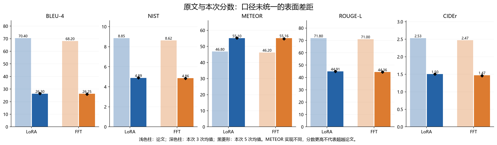
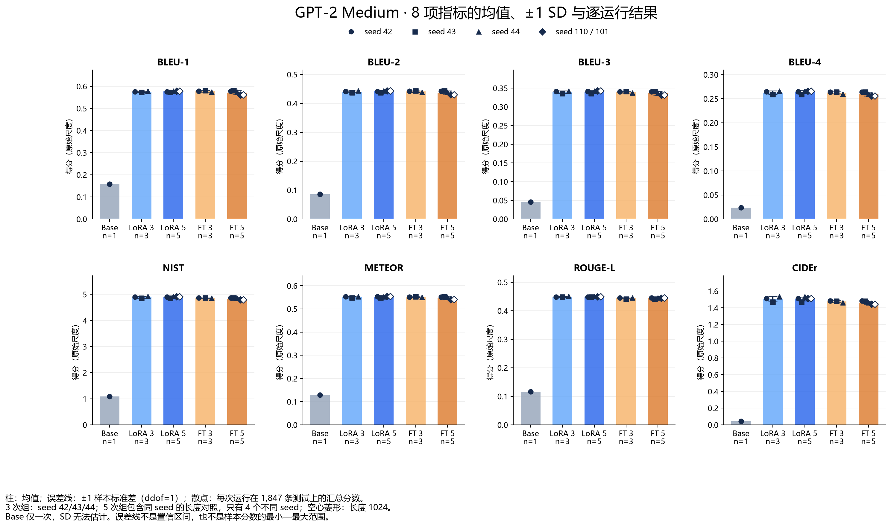
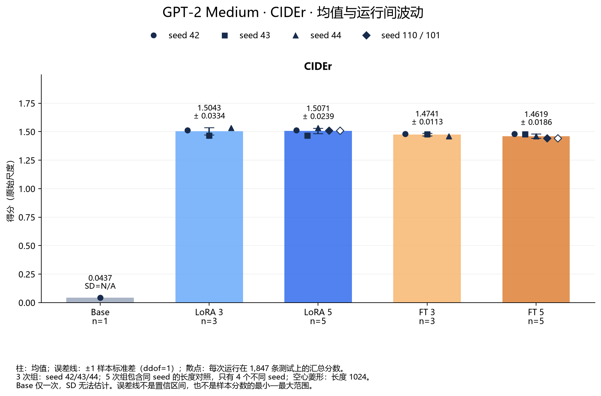
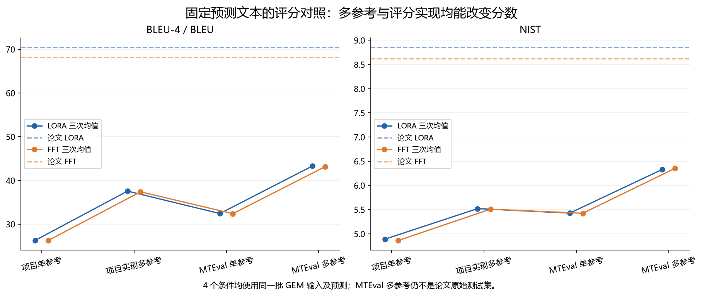
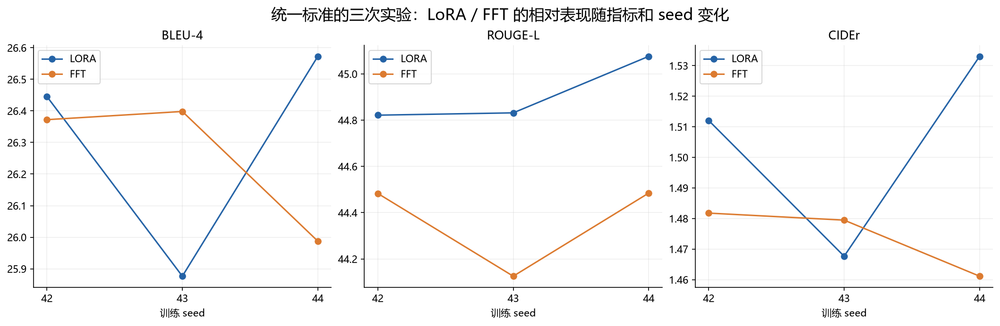

# GPT-2 Medium / E2E：与 LoRA 原文的数据一致性及差异原因报告

日期：2026-10-17。结果来自当前仓库 `outputs/benchmarks` 的 11 个正式 benchmark；代码基线为 `117a9d1`。用户确认当前代码与家庭电脑实际运行代码一致。本报告不改写原始结果，也未重新训练模型。

## 1. 结论

**本次结果与原文的绝对分数不一致，目前不能称为完成了原文数值复现。已有证据首先指向数据集与评分口径不同，不能据此判定模型训练失败。**

- 原始三次均值中，LoRA 的 BLEU-4 为 **26.298**，论文为 **70.4**；NIST 为 **4.891**，论文为 **8.85**。这不是单纯把 0–1 分数乘 100 就能消除的差距。
- 固定模型预测、把参考文本由第一条改为全部，再换成官方流程使用的 Python MTEval 评分代码，LoRA 的 BLEU 变为 **43.281**、NIST 变为 **6.330**。因此，**评分协议确实解释了一部分差距**；仍有 **27.119 BLEU / 2.520 NIST** 的表面差值未消除。这部分尚不能直接解释为模型能力差距，因为测试输入集合仍不同。
- **相对趋势只部分一致**：原始三次均值下，LoRA 的 BLEU-4、NIST、ROUGE-L、CIDEr 略高于 FFT，METEOR 略低；BLEU-4 的领先仅 **0.0457**，不能写成稳定、全面优于 FFT。
- **3 次与 5 次均值会改变“领先多少”的印象，但不改变当前不具备严格论文可比性的判断。**主分析采用 seed 42/43/44，5 次均值按用户要求完整保留，并在第 4 节单独解释其影响。
- **512/1024 没有造成训练或验证样本截断差异**：实际编码长度上限分别为 124 / 135 tokens。LoRA 两条长度对照记录预测完全一致；FFT 有少量分数差异，现有证据不能将其归因于长度截断。

## 2. 实验分组与比较规则

|用途|LoRA|FFT|解释|
|---|---|---|---|
|主要三次均值|seed 42/43/44，max_length=512|seed 42/43/44，max_length=1024|各方法内部配置统一；两种方法保留各自标准设置|
|五次均值|三次组 + seed 110 的 512/1024 两条记录|三次组 + seed 101 的 512/1024 两条记录|全部五个记录的算术均值，不等于五个独立种子|
|长度对照|seed 110：512 对 1024|seed 101：512 对 1024|固定各方法的原始种子，观察训练长度变化|
|未微调基线|GPT-2 Medium Base 一次|同一个 Base|仅说明任务适配效果，原文表 3 无对应未微调行|

训练 seed 来自 `config.json → model.training_config.seed`；所有 benchmark 外层生成配置的 `seed=42`，不能把它误当成所有模型的训练 seed。全部运行均为 test、1,847 条、beam=10、max_new_tokens=64、length_penalty=0.9、no_repeat_ngram_size=4。预测采用确定性 beam search。

展示尺度：BLEU-1～4、METEOR、ROUGE-L 均为原始分数 ×100；NIST、CIDEr 保留原始尺度。论文 BLEU 对照本次 BLEU-4；论文没有给出该表的 BLEU-1～3。下面的差值表示“本次 − 论文”，是口径尚未统一时的描述性差值，不能用作同条件效果检验。

## 3. 与原文直接对照：绝对数值不一致

原文参照 **LoRA v2 表 3 的 GPT-2 Medium 行**，不混用 GPT-2 Large、Small 或其他数据集。原文 FT 行带星号，来自 Li & Liang (2021)，不是 LoRA 作者在同一表中重新运行的 FT 结果。[原文表 3 与 D.3](https://arxiv.org/html/2106.09685#S5.T3)

|方法|指标|论文|本次 3 次均值|3 次差值|本次 5 次均值|5 次差值|
|---|---|---|---|---|---|---|
|LORA|BLEU-4|70.400|26.298|-44.102|26.410|-43.990|
|LORA|NIST|8.850|4.891|-3.959|4.900|-3.950|
|LORA|METEOR|46.800|55.098|+8.298|55.201|+8.401|
|LORA|ROUGE-L|71.800|44.910|-26.890|44.928|-26.872|
|LORA|CIDEr|2.530|1.504|-1.026|1.507|-1.023|
|FFT|BLEU-4|68.200|26.253|-41.947|25.987|-42.213|
|FFT|NIST|8.620|4.861|-3.759|4.834|-3.786|
|FFT|METEOR|46.200|55.162|+8.962|54.717|+8.517|
|FFT|ROUGE-L|71.000|44.364|-26.636|44.416|-26.584|
|FFT|CIDEr|2.470|1.474|-0.996|1.462|-1.008|

这里 METEOR 的反向差异尤其重要：本次得分比论文高，不能解释为模型超越原文。项目使用 NLTK METEOR 的逐句平均，官方 E2E 流程使用 COCO 包装的 METEOR 实现；匹配、归一化和汇总协议不同。只做 ×100 并没有统一算法。

本次三次实验的离散程度如下，`±` 为 **样本标准差（ddof=1）**。论文表 3 将自己的区间称为 confidence intervals，不能直接把本表标准差与原文区间当作同一种统计量。[原文说明](https://arxiv.org/html/2106.09685#S5.T3)

|指标|LoRA：均值 ± 样本标准差|FFT：均值 ± 样本标准差|
|---|---|---|
|BLEU-4|26.2984 ± 0.3708|26.2527 ± 0.2299|
|NIST|4.8912 ± 0.0327|4.8614 ± 0.0033|
|METEOR|55.0977 ± 0.2786|55.1621 ± 0.1491|
|ROUGE-L|44.9098 ± 0.1441|44.3645 ± 0.2070|
|CIDEr|1.5043 ± 0.0334|1.4741 ± 0.0113|

## 4. 3 次和 5 次均值：是否影响结论

|指标|LoRA 3 次|LoRA 5 次|5−3|FFT 3 次|FFT 5 次|5−3|
|---|---|---|---|---|---|---|
|BLEU-1|57.5744|57.6838|+0.1094|57.7808|57.1223|-0.6586|
|BLEU-2|44.0570|44.1767|+0.1196|44.0987|43.6553|-0.4434|
|BLEU-3|33.9608|34.0781|+0.1172|33.9659|33.6400|-0.3260|
|BLEU-4|26.2984|26.4102|+0.1118|26.2527|25.9869|-0.2657|
|NIST|4.8912|4.8997|+0.0085|4.8614|4.8344|-0.0270|
|METEOR|55.0977|55.2012|+0.1035|55.1621|54.7170|-0.4451|
|ROUGE-L|44.9098|44.9284|+0.0187|44.3645|44.4163|+0.0518|
|CIDEr|1.5043|1.5071|+0.0029|1.4741|1.4619|-0.0122|

**有影响，但影响主要是统计混合方式，而非增加两个独立种子的证据。**

LoRA 加入的两条 seed=110 记录，1,847 条预测逐条完全相同；因此五次均值对这组相同预测赋予 2/5 权重。它们属于有意设置的同 seed 长度对照，五次均值描述的是五份实验记录，而不是五个独立 seed。FFT 新增两条 seed=101 记录，其 BLEU-1～4、NIST、METEOR、CIDEr 低于 seed 42/43/44 的平均值，使这些指标的五次均值下降；ROUGE-L 则小幅上升。五次均值同时改变种子构成与长度构成，不能将 5−3 全归因为某一个因素。

|需要说明的变化|三次均值|五次均值|含义|
|---|---|---|---|
|LoRA−FFT 的 BLEU-4|+0.0457|+0.4232|五次混合后，视觉上会放大 LoRA 的领先幅度|
|LoRA−FFT 的 METEOR|-0.0644|+0.4842|正负号发生改变；“所有指标都领先”依赖分组方式|

**报告引用规则：主要结果引用三次均值，五次均值作为补充描述；涉及长度影响时，只引用第 7 节的同 seed 对照。**

### 4.1 不同训练 seed 的标准差与逐运行分布

以下图表按用户要求使用 **Base、LoRA 3、LoRA 5、FT 3、FT 5** 五组。每根柱子表示均值；顶部误差线表示 **均值 ±1 个样本标准差（ddof=1）**，并叠加每次完整测试运行的散点。散点不是 1,847 条测试输入各自的分数；误差线也不是最小—最大范围、标准误或置信区间。所有图表均保留原始分数尺度，BLEU、METEOR、ROUGE-L 未乘 100。

Base 只有一次运行，标准差记为 N/A，不把无法估计写成零。三次组是 seed 42/43/44，方法内部训练配置一致；五次组只有四个不同 seed，其中 LoRA seed=110、FT seed=101 各含两种长度。五次组的 SD 描述五份记录的混合波动，不能当成五个独立 seed 的波动，也不能把 LoRA 相同预测的两条记录视作两份独立证据。LoRA 3 与 LoRA 5、FT 3 与 FT 5 有重叠，不能视作独立实验组。

表中单元格为“均值 ± 样本标准差 / CV”。CV=100×SD/均值，用于比较不同量纲的相对波动；单次 Base 不计算 CV。完整精度结果与每一个散点的运行 ID 分别保存在 `variability_summary.csv`、`variability_runs.csv`。

|指标|Base（单次 / SD 不可估计）|LoRA 3|LoRA 5（混合）|FT 3|FT 5（混合）|
|---|---|---|---|---|---|
|BLEU-1|0.15804 / N/A|0.57574 ± 0.00279 / 0.48%|0.57684 ± 0.00248 / 0.43%|0.57781 ± 0.00318 / 0.55%|0.57122 ± 0.00929 / 1.63%|
|BLEU-2|0.08629 / N/A|0.44057 ± 0.00304 / 0.69%|0.44177 ± 0.00270 / 0.61%|0.44099 ± 0.00280 / 0.64%|0.43655 ± 0.00639 / 1.46%|
|BLEU-3|0.04604 / N/A|0.33961 ± 0.00347 / 1.02%|0.34078 ± 0.00293 / 0.86%|0.33966 ± 0.00245 / 0.72%|0.33640 ± 0.00479 / 1.42%|
|BLEU-4|0.02364 / N/A|0.26298 ± 0.00371 / 1.41%|0.26410 ± 0.00304 / 1.15%|0.26253 ± 0.00230 / 0.88%|0.25987 ± 0.00399 / 1.53%|
|NIST|1.09160 / N/A|4.89115 ± 0.03271 / 0.67%|4.89969 ± 0.02592 / 0.53%|4.86140 ± 0.00330 / 0.07%|4.83442 ± 0.03701 / 0.77%|
|METEOR|0.12854 / N/A|0.55098 ± 0.00279 / 0.51%|0.55201 ± 0.00243 / 0.44%|0.55162 ± 0.00149 / 0.27%|0.54717 ± 0.00619 / 1.13%|
|ROUGE-L|0.11588 / N/A|0.44910 ± 0.00144 / 0.32%|0.44928 ± 0.00105 / 0.23%|0.44364 ± 0.00207 / 0.47%|0.44416 ± 0.00164 / 0.37%|
|CIDEr|0.04369 / N/A|1.50426 ± 0.03338 / 2.22%|1.50714 ± 0.02393 / 1.59%|1.47413 ± 0.01131 / 0.77%|1.46189 ± 0.01857 / 1.27%|

CIDEr 的三 seed 结果：LoRA **1.50426 ± 0.03338，CV=2.22%**；FT **1.47413 ± 0.01131，CV=0.77%**。五记录补充组的 CV 分别为 **1.59% / 1.27%**。当前 Medium 的这些记录没有显示此前 Small 中那种大幅 CIDEr 相对波动，但三 seed 仅有三次训练，没有各 seed 的独立重跑，不能据此证明问题已经消失。评分口径一致性与跨 seed 稳定性也是不同问题；分数稳定并不能消除本报告确认的数据集与参考集合差异。

**与 Small 旧记录的边界**：已核对 Small 的 `outputs/benchmarks/fft_benchmark_summary_20261006_1852-1944.csv`：六次 FT（seed 42/43/44 各两次）的 CIDEr 均值为 0.060558、样本 SD 为 0.033316、CV 为 55.02%。该批保存的评测配置使用 **validation 1,484 条、max_new_tokens=60**；Medium 当前使用 **test 1,847 条、max_new_tokens=64**，且每个主分析 seed 仅一次训练。两批结果没有统一测试集、解码配置与重复运行设计，不能把 CV 的降低直接归因于 Medium 模型规模。Small 原始摘要与配置证据已另存为 [small_stability_reference.json](small_stability_reference.json)，只作历史描述对照。

八项独立大图（均有同名 SVG）：[BLEU-1](figures/variability_BLEU-1.png)、[BLEU-2](figures/variability_BLEU-2.png)、[BLEU-3](figures/variability_BLEU-3.png)、[BLEU-4](figures/variability_BLEU-4.png)、[NIST](figures/variability_NIST.png)、[METEOR](figures/variability_METEOR.png)、[ROUGE-L](figures/variability_ROUGE-L.png)、[CIDEr](figures/variability_CIDEr.png)。复跑命令：`python analysis/seed_variability.py`；运行 `python analysis/build_report.py` 会一起更新图表及本报告。脚本先核对审计记录中的原始文件 SHA-256，避免用旧审计数据绘制新实验结果。

## 5. 差异原因一：评分时只使用了第一条参考——已做受控验证

当前 [`src/utils/scoring.py`](../src/utils/scoring.py) 的 `score()` 明确构造 `gts = {i: [row["target"]] ...}`。BLEU、NIST、METEOR、ROUGE-L、CIDEr 都没有使用保存的全部 `references`。数据加载器把 `target` 设为第一条参考，记录也逐条满足 `target == references[0]`。

完整性核验得到：

|审计项|结果|
|---|---|
|正式 benchmark 数量|11，全部 completed，无评分 errors|
|每个运行的预测条数|1,847，ID/MR/target/references 与其他运行逐条相同|
|参考总数|4,693|
|只有一条参考的输入|828 / 1,847（44.83%）|
|有多条参考的输入|1,019 / 1,847（55.17%）|
|每个输入参考数|平均 2.541，最多 35|

以下对照**完全固定已有预测**，只切换第一条参考/全部参考。所有分数取 seed 42/43/44 三次均值。COCO 与 NLTK 的“单参考”列重新计算后，与原 benchmark 对应分数的绝对误差均小于 `1e-10`；共核对 11×4=44 个分数。因此没有发现这四项原始分数的汇总或抄录错误。

|方法|指标实现|第一条参考|全部参考|增加量|
|---|---|---|---|---|
|LORA|BLEU-4（COCO）|26.2984|37.5608|+11.2624|
|LORA|NIST（NLTK）|4.8912|5.5210|+0.6299|
|LORA|ROUGE-L（未加 PTB）|44.9098|51.9792|+7.0694|
|LORA|CIDEr（未加 PTB）|1.5043|1.5765|+0.0722|
|LORA|BLEU（MTEval）|32.4282|43.2813|+10.8531|
|LORA|NIST（MTEval）|5.4291|6.3302|+0.9011|
|FFT|BLEU-4（COCO）|26.2527|37.3996|+11.1469|
|FFT|NIST（NLTK）|4.8614|5.5094|+0.6480|
|FFT|ROUGE-L（未加 PTB）|44.3645|51.2999|+6.9354|
|FFT|CIDEr（未加 PTB）|1.4741|1.5538|+0.0797|
|FFT|BLEU（MTEval）|32.3988|43.1527|+10.7539|
|FFT|NIST（MTEval）|5.4253|6.3539|+0.9286|

两种作用可以分开看：

1. **参考集合的作用**：比较同一个实现内的“第一条 / 全部”两列，可以确认丢弃参考文本使这些记录的得分下降。
2. **评分实现的作用**：在同一个参考条件下，比较项目的 COCO BLEU / NLTK NIST 与 MTEval 的 BLEU / NIST，可以确认分词、大小写与算法实现也会改变数值。项目直接传入原始字符串/空白分词，MTEval 自带文本处理。

例如 LoRA 的 BLEU 从原始 26.298 到 MTEval 多参考 43.281，增加 16.983，约占原始表面 BLEU 差值的 38.5%。这只是本次改变评分协议后的算术分解，**不是对论文差距的完整因果解释**。该重评分结果仍是 GEM 任务上的诊断结果。

**相对排名也受协议影响**：原始单参考 NLTK NIST 中，LoRA−FFT 为 +0.0298；改成 MTEval 多参考后变为 -0.0237（LoRA 6.3302，FFT 6.3539）。因此，评分差异不仅改变绝对分数，也可能改变某一指标上的优劣次序，不能只用原始三次均值宣称复现了原文的全面领先。

本次没有运行完整官方 COCO/PTB/Java METEOR 流程：当前分析环境 PATH 中未找到 Java。上表 ROUGE-L/CIDEr 仅改变参考集合，仍未经过官方 PTB 流程；METEOR 没有新增“官方复现分数”。不能把这份重评分表命名为“官方完整评测结果”。[官方 E2E 评分入口](https://github.com/tuetschek/e2e-metrics/blob/master/measure_scores.py)

## 6. 差异原因二：数据集内容与 MR 分组不同——已核对源文件

本项目使用 `GEM/e2e_nlg`，其加载器训练端读取清洗后的 `train-fixed.no-ol.csv`，测试端读取 GEM 分组后的 JSON；LoRA 官方流程直接处理仓库中的 `data/e2e/train.txt`、`test.txt`。这不是两个名称指向相同文件。[GEM 加载器](https://huggingface.co/datasets/GEM/e2e_nlg/blob/main/e2e_nlg.py)、[LoRA 数据处理入口](https://github.com/microsoft/LoRA/blob/main/examples/NLG/create_datasets.sh)

|项目|本次 GEM 数据|LoRA 官方公开数据快照|意义|
|---|---|---|---|
|训练样本/参考行数|33,525|42,061|相同 5 epochs 的样本量、更新步数及训练分布均不同|
|测试输入 MR 数|1,847|630|测试任务的输入集合与参考分组不同|
|测试参考总数|4,693|4,693|总参考数相同不等于任务相同|
|每个测试输入平均参考数|2.541|7.449|GEM 分组较细，参考匹配机会也不同|

这些数量来自下载源文件的实际计数；GEM test 中 MR、参考数组与本次全部预测记录逐条一致。官方测试的 4,693 行按官方 context 分组后是 630 个输入，而当前 GEM 记录本身就是 1,847 个不同 MR，**不是“把 4,693 条测试漏跑成 1,847 条”**。GEM 数据卡明确说明其清洗包含 MR 修正与重叠清除；这可能把原来同一输入下的参考分到不同输入。当前对照能确认任务已经变化，但不能给这类变化分配一个独立的性能损失百分比。[GEM 数据结构与清洗说明](https://huggingface.co/datasets/GEM/e2e_nlg#dataset-structure)

训练样本减少 8,536 条，约 20.29%；LoRA 每 epoch 从官方约 5,258 个 batch 变为当前约 4,191 个 batch（batch=8，尾 batch 处理会影响精确值），相同的 warmup=500 对应不同训练比例。这里数量不同是事实，对最终分数的独立贡献尚需统一训练数据重跑才能确定。

**因此，即使把当前预测改为多参考评分，仍不能直接与原文 70.4 BLEU 认定为同条件复现。**本次 MTEval 多参考的 LoRA / FFT 分别为 43.281 / 43.153 BLEU、6.330 / 6.354 NIST；残余差异也不能全部归到优化器或 seed 上。

## 7. 长度与 seed 对照：哪些确实产生影响

### 7.1 相同 seed 下的 512 / 1024

|方法|固定 seed|指标|max_length=512|max_length=1024|1024−512|
|---|---|---|---|---|---|
|LORA|110|BLEU-4|26.57783|26.57783|+0.00000|
|LORA|110|NIST|4.91250|4.91250|+0.00000|
|LORA|110|METEOR|55.35642|55.35642|+0.00000|
|LORA|110|ROUGE-L|44.95645|44.95645|+0.00000|
|LORA|110|CIDEr|1.51145|1.51145|+0.00000|
|FFT|101|BLEU-4|25.57341|25.60326|+0.02985|
|FFT|101|NIST|4.79343|4.79450|+0.00107|
|FFT|101|METEOR|54.00759|54.09129|+0.08370|
|FFT|101|ROUGE-L|44.46629|44.52175|+0.05546|
|FFT|101|CIDEr|1.44286|1.44420|+0.00133|

|核验项|LoRA seed=110|FFT seed=101|
|---|---|---|
|两种长度的预测完全相同|1,847 / 1,847|1,598 / 1,847|
|预测文本不同|0|249（13.48%）|
|能否据此认为 1024 提升有效输入信息|不能|不能|

这里用缓存的 GPT-2 Medium tokenizer，严格按 [`tokenize()`](../src/utils/data.py) 的方式分别编码提示词与带前导空格的 target，再加 EOS，检查了公开源文件的全部训练/验证样本：

|数据|样本数|未截断时最大 tokens|超过 512|超过 1024|
|---|---|---|---|---|
|train|33,525|124|0|0|
|validation（每 MR 第一条参考）|1,484|135|0|0|

代码采用动态 padding，`max_length` 用于切片，不会把每条样本强行补到该长度。因此在这份数据和代码下，512 改为 1024 **没有改变进入模型的训练/验证 token 序列**。这很好地解释了 LoRA 长度对照的相同预测，也排除了“FFT 因 512 截断而变差”这一解释。

FFT 的 BLEU-4 差 0.02985（展示尺度），其他指标差值也很小。相同 seed 并不自动保证 GPU 训练逐位相同，当前代码没有显式启用严格确定性算法；数值扰动、运行状态、权重保存/加载等可造成不同预测。但这只是后续核验方向，**不能仅凭现有 benchmark 指定唯一原因**。训练权重、家庭电脑的完整 Trainer 状态和逐步日志尚未在本报告中逐一匹配，不能据此断言权重相同或不同。

长度统计依据下载的当前 GEM 数据快照和本地 GPT-2 tokenizer；来源哈希见 `sources_manifest.json` / `length_audit.json`。这提供了有力的无截断证据，但原始训练记录若实际使用其他数据修订版，还需以当次训练缓存/指纹作最终核验。

### 7.2 seed 42/43/44 的变化与相对趋势

下表全部为 LoRA−FFT；同 seed 列按 42 / 43 / 44 排列，仍保留各方法自己的标准训练设置。

|指标|论文 LoRA−FT|本次 3 次均值差|本次 5 次均值差|本次同 seed 差（42 / 43 / 44）|
|---|---|---|---|---|
|BLEU-4|+2.2000|+0.0457|+0.4232|+0.0735, -0.5216, +0.5852|
|NIST|+0.2300|+0.0298|+0.0653|+0.0363, -0.0080, +0.0610|
|METEOR|+0.6000|-0.0644|+0.4842|+0.0834, -0.5144, +0.2378|
|ROUGE-L|+0.8000|+0.5453|+0.5122|+0.3384, +0.7063, +0.5913|
|CIDEr|+0.0600|+0.0301|+0.0452|+0.0303, -0.0118, +0.0719|

BLEU-4 在 seed=43 上出现 LoRA 低于 FFT，说明三次平均的微小正差并非每个种子都成立。三次组中 ROUGE-L 每个 seed 都由 LoRA 领先；其他指标仍有波动。样本只有三个训练种子，没有进行同协议的大规模重复或显著性检验，应写为“当前均值接近、部分指标略优”，不能写为稳定压倒 FFT。

## 8. 训练与解码设置：已对齐部分与仍存差异

|检查项|当前代码 / 记录|原文 / 官方来源|判断|
|---|---|---|---|
|LoRA 学习率、epoch、batch、warmup|2e-4 / 5 / 8 / 500|原文表 11 相同|已对齐|
|LoRA Q/V rank、alpha、weight decay、label smoothing|4 / 32 / 0.01 / 0.1|原文表 11 相同|已对齐|
|LoRA dropout|adapter=0.1，基础 GPT-2 dropout=0|官方实现对应结构|不是把 FFT 的基础 dropout 直接套给 LoRA|
|FFT 的学习率、epoch、batch|5e-5 / 5 / 10|项目按 Prefix-Tuning FT 基线配置|大项对齐不代表实现完全相同|
|提示词|`MR: …` + 换行 + `Text:`|官方输入为 `name : …`、`Type : …` 等竖线分隔的 context 格式|文本格式确有不同，独立影响未量化|
|beam / 最大生成长度 / 禁重复 ngram|10 / 64 / 4|官方示例相同|不能首先归因为 beam 或生成上限设置错|
|length penalty|0.9|论文表 11=0.9；当前官方 README 示例=0.8|项目对齐论文表，不等于逐字复刻 README 命令|
|生成终止 / 文本清理|HF `generate()` 默认模型 EOS，strip 后评分|官方示例 EOS=628，解码再按双换行截断|确有流程差异，未做固定模型生成消融|
|梯度裁剪|HF TrainingArguments 未覆盖 max_grad_norm，使用框架默认|官方示例 `--clip 0.0`|存在实现差异；不能量化为主因|
|最佳模型选择|每 epoch 验证，以 eval_loss 取最佳|原文 D.3 说明最佳 epoch|大策略接近；当次最佳 checkpoint 尚未逐一验证|

本段主要证据来自当前 `src/utils/training.py`、`data.py`、`evaluation.py` 及保存的 `training_config`；官方对照见 [NLG 复现命令](https://github.com/microsoft/LoRA/tree/main/examples/NLG#replicating-our-result-on-e2e)、[官方解码代码](https://github.com/microsoft/LoRA/blob/main/examples/NLG/src/gpt2_decode.py)。表 11 与 README 的 length penalty 本身不完全一致，报告保留这种源间差异，不将当前 0.9 直接判为错误。

## 9. 原因判断与最省成本的下一步

|候选原因|当前证据强度|已经知道什么|仍需什么才能闭环|
|---|---|---|---|
|单参考替代多参考|高，已有固定预测重评分|分数随参考集合明显改变|使用论文原始 MR/参考分组评分|
|评分库/分词/归一化不同|高，BLEU/NIST 已作同参考对照|算法差异解释部分分差；METEOR 原分不可直接对标|完整官方 E2E 包、PTB 与 Java METEOR|
|GEM 清洗数据替代原始数据|高，源文件数量和结构不同|训练样本、测试输入与分组均变化|统一原始数据后评测；必要时重新训练|
|seed 构成及 3/5 均值混合|高，已有全部运行配置|会改变领先幅度与 METEOR 正负关系|主结论固定三次组，长度组分开|
|512/1024 的截断差异|当前数据证据不支持|两种上限都未截断训练/验证样本|保留当次数据/分词器哈希后进一步核实|
|提示词、EOS、beam 实现、优化器细节|确有部分实现差异，贡献未证实|不能由配置大项相同推导出严格复现|固定权重单因素生成对照；之后再考虑训练消融|
|训练未完成、权重损坏、GPU 型号导致分数差距|目前证据不足|benchmark 均成功，不能据分差直接判定这类根因|当次训练状态、checkpoint、权重与加载记录|

建议按以下顺序补实验，避免过早重跑全部模型：

1. 保存本报告和现有原始 benchmark，保留“项目单参考”历史分数。若将来新增官方评分，使用独立 profile 和目录。
2. 在现有已训练权重上，对 LoRA 官方的 630 个原始 test 输入重新生成，使用官方 context 格式对应的方案，并用完整官方 E2E 脚本评分；这能优先分清评测协议与模型训练差异。提示词格式改变可能带来分布变化，应同时保留模型训练时使用的格式作为生成对照，不能直接覆盖。
3. 如果统一测试集和评分流程后仍有明显差距，再将训练集也换成官方 42,061 行版本，先用一个 seed 验证全链路；验证后再完成 42/43/44 三次对照。统一训练数据前，不能把残差归结为 rank、学习率或 epoch 不足。
4. FFT 长度对照可先在同一数据、同一初始化权重、严格确定性设置下做重复运行，记录输入 token 哈希和模型权重哈希；因为已无截断差异，这一步用于定位可重复性，而非验证“更长上下文”的收益。

这些是后续建议，本次没有改动训练、生成或评分主程序，没有启动上述新增实验。

## 10. 完整单次结果与可追溯附件

|运行标签|BLEU-4|NIST|METEOR|ROUGE-L|CIDEr|
|---|---|---|---|---|---|
|Base|2.3635|1.0916|12.8536|11.5877|0.0437|
|FFT-s101-L1024|25.6033|4.7945|54.0913|44.5217|1.4442|
|FFT-s101-L512|25.5734|4.7934|54.0076|44.4663|1.4429|
|FFT-s42-L1024|26.3723|4.8636|55.1960|44.4832|1.4818|
|FFT-s43-L1024|26.3982|4.8630|55.2913|44.1254|1.4795|
|FFT-s44-L1024|25.9876|4.8576|54.9990|44.4847|1.4611|
|LORA-s110-L512|26.5778|4.9125|55.3564|44.9564|1.5114|
|LORA-s42-L512|26.4457|4.8999|55.2794|44.8216|1.5121|
|LORA-s43-L512|25.8766|4.8550|54.7769|44.8316|1.4677|
|LORA-s44-L512|26.5728|4.9186|55.2368|45.0760|1.5330|
|LORA-s110-L1024|26.5778|4.9125|55.3564|44.9564|1.5114|

|附件|内容|
|---|---|
|[run_metrics.csv](run_metrics.csv)|全部 11 次原始指标及运行目录；分数保持原始尺度|
|[variability_summary.csv](variability_summary.csv)|8 项指标×5 组的均值、样本 SD、CV、范围和样本数|
|[variability_runs.csv](variability_runs.csv)|每一个绘图散点的运行 ID、seed、长度及分数|
|[seed_variability.py](seed_variability.py)|核对原始数据哈希后生成 8 张误差线单图与 1 张总览|
|[rescoring.csv](rescoring.csv)|每次运行、每种参考条件的受控重评分；分数保持原始尺度|
|[audit_results.json](audit_results.json)|配置、原始分数、重评分、输入文件哈希、预测文本哈希|
|[data_audit.json](data_audit.json)|样本数量、MR 数量、参考分布核验|
|[length_audit.json](length_audit.json)|编码长度、tokenizer 哈希、预测一致条数|
|[sources_manifest.json](sources_manifest.json)|下载的官方/GEM 源文件 URL、大小、SHA-256|
|[analyze_consistency.py](analyze_consistency.py)|只读原 benchmark，重新核算分数及数据结构|
|[length_audit.py](length_audit.py)|独立核验编码长度和长度组预测|
|[build_report.py](build_report.py)|从审计结果生成 Markdown、PNG 与 SVG|
|[prepare_sources.py](prepare_sources.py)|下载并核验 manifest 中的源文件|
|[validation.json](validation.json)|分数复算、源文件哈希、表格/图片/链接与历史保留检查结果|

本次评分环境的 pycocoevalcap=1.2，与原 benchmark 保存版本一致；NIST 重新计算吻合。原始记录还保存 torch=2.14.0+cu130、transformers=5.17.0、datasets=2.21.0、peft=0.21.0、nltk=3.10.3。上述版本来自当次 `environment.json`，不等于本地分析环境版本。本地分析使用 Python 3.14.6、NLTK 3.10.0；与当次 NLTK 版本不同，但 NIST 原分复算吻合，未将本地 METEOR 当作原始或官方 METEOR 重算结果。

审计临时依赖和下载快照位于 `outputs/smoke/report_audit`，不混入正式 benchmark。运行审计需要 numpy、nltk、matplotlib、future、pycocoevalcap=1.2，以及长度统计使用的 tokenizers；依赖与外部源码保持独立。后续复跑时可运行 `python analysis/prepare_sources.py` 获取 manifest 内文件（校验哈希），再运行 `analyze_consistency.py`、`length_audit.py`、`build_report.py`。

公开源码/数据快照读取于 2026-10-17；manifest 固定其内容哈希，但它们不构成论文作者当年运行环境的完整封存。本报告中**已证实的协议差异**与**未归因的剩余差距**已分别标注，后者不应写成已经查明的唯一训练根因。
